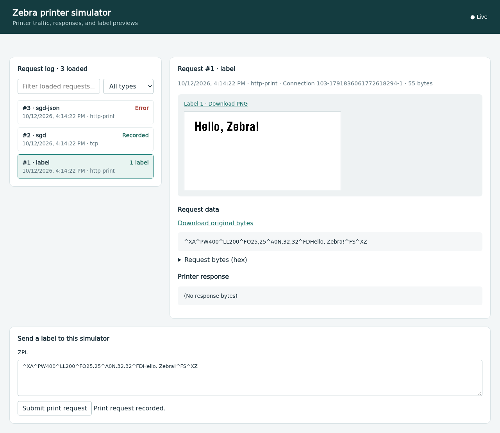

# Zebra printer simulator

A local network printer simulator with SQLite request history and a realtime
web UI. It accepts printer traffic, renders labels with the workspace's local
ZPL renderer, and stores the original request bytes, printer responses, errors,
warnings, and a PNG for every rendered label. It never contacts a physical
printer or a rendering service.

```sh
direnv exec . cargo run --locked -p zebra-simulator
```

Open <http://127.0.0.1:9170/>. Default listeners:

| Listener | Purpose |
| --- | --- |
| `127.0.0.1:9100` | Bidirectional raw TCP: ZPL, classic SGD, and SGD JSON |
| `127.0.0.1:9200` | SGD JSON configuration port |
| `127.0.0.1:9170` | Request UI, history API, HTTP printing and previews |

Use `--tcp-addr`, `--json-addr`, and `--http-addr` to change the addresses, including
binding to your LAN for application testing. The listeners have no authentication.
`--database` defaults to `_simulator.sqlite`; migrations run automatically.
Binding HTTP to a LAN address does not open the system firewall or change the
TCP/JSON listener addresses. If remote HTTP connections time out while a local
request succeeds, allow the configured HTTP port on the LAN interface. For
example, in the NixOS configuration of the system/container running the simulator:

```nix
networking.firewall.interfaces."LAN_INTERFACE".allowedTCPPorts = [ 9170 ];
```

Replace `LAN_INTERFACE` with the actual interface name and rebuild that
system/container. See [NixOS interface-specific firewall rules](https://wiki.nixos.org/wiki/Firewall#Interface_specific_rules).

The binary embeds its UI and migrations and works from any current directory.
Run `--help` for initial width, height, model, serial, and firmware options.
The simulator uses 203 DPI and the explicit ZD621 rendering profile. Identity
and settings initialize a new database; an existing database retains its values.

Send a label:

```sh
printf '^XA^PW400^LL200^FO25,25^A0N,32,32^FDHello, Zebra!^FS^XZ' | nc -N 127.0.0.1 9100
curl --data-binary @docs/examples/local-label.zpl http://127.0.0.1:9170/pstprnt
```

SGD uses CRLF-terminated commands on a persistent bidirectional connection:

```text
! U1 setvar "device.location" "test desk"
! U1 getvar "device.location"
```

The second command returns `"test desk"` followed by CRLF. Classic `setvar`
does not reply. On either TCP port, JSON needs no newline:

```text
{}{"device.location":"test desk","device.friendly_name":null}
```

JSON null gets, string sets, multi-key batches, branch gets, `allvalues`, and
`allconfig` are supported. JSON responses contain the resulting values, including
unchanged values when a set fails. Unknown classic gets return `"?"`; unknown
JSON gets return null. Writable settings are `device.location`,
`device.friendly_name`, `device.company_name`, `device.company_contact`,
`ezpl.print_width`, `zpl.label_length`, `media.speed`, `print.tone`,
`device.languages` (only `zpl`), and `device.pause` (`on`/`off`). Dimensions
must be 1–4096 dots and remain subject to the renderer's pixel budget. Speed and
tone are stored configuration values and do not change preview pixels.
Identity, resolution, and `odometer.total_label_count` are read-only.

Supported classic `do` actions: `device.pause`, `device.unpause`, `device.reset`,
and `formats.cancel_all`. Reset clears pause; it preserves identity/settings and
history. Unsupported actions and setting writes are retained with an error. JSON `allconfig`
returns synthetic value/type/access metadata, not firmware capability information.

ZPL controls `~HS`, `~HI`, `^HH`, `~PP`, `~PS`, `~JA`, and `~JR` have explicit
synthetic status/identity/configuration/pause/reset behavior. Status records
report no physical sensor errors and no deferred queue. A paused print is logged
as an error rather than queued; a preview can still be rendered. Successful
prints increment the label odometer. Preview requests do not increment it.

HTTP `POST /pstprnt` accepts raw printer data. `POST /zpl` accepts the Zebra
preview form's `data` field and returns HTML with an uppercase ``,
compatible with this workspace's `zebra-http-api` client. Form credentials are
not persisted. Multipage prints/previews store all rendered pages; the Zebra
preview HTML selects the first. Unsupported rendering returns HTTP 422 and a
persisted error. Invalid/oversized HTTP bodies/forms have rejection metadata
logged without body bytes. UI asset/history/image reads are not printer requests.

The UI includes request types, timestamps, transport and connection grouping,
errors, renderer warnings, original-byte downloads, hex inspection, responses,
and per-label PNG downloads. It updates through SSE and recovers missed rows
using the database cursor after reconnects. Filtering applies to loaded history;
load older requests to inspect the entire log.



[Mobile request log](docs/screenshots/mobile.png). These reference screenshots
come from the loopback browser test described below.

| History endpoint | Result |
| --- | --- |
| `GET /api/requests` | Latest 100 metadata rows, newest first |
| `GET /api/requests?before=ID` | Up to 100 older rows, newest first |
| `GET /api/requests?after=ID` | Up to 100 newer rows, oldest first |
| `GET /api/requests/ID` | Metadata, text and lossless byte arrays |
| `GET /api/requests/ID/raw` | Original binary request download |
| `GET /api/requests/ID/labels/PAGE` | PNG, zero-based page |
| `GET /api/events` | SSE `requests` events with latest committed ID |

TCP writes/read chunks are not request boundaries. The server frames complete
SGD lines, JSON objects, and ZPL formats (`^XA`…`^XZ`, including control-character
aliases) and can accept fragmented or coalesced traffic. Binary framing uses the
existing ZPL parser. Whitespace between requests is ignored. Partial requests
are retained on disconnect, idle timeout, read failure, and Ctrl-C shutdown.
Malformed JSON closes its connection with a logged error. Requests are capped
at 1 MiB (oversized TCP requests retain only a bounded prefix). Each listener
services up to 64 sockets, with 30-second read-idle and 5-second write deadlines.
Database/render work is serialized off the async executor with bounded workers.
SQLite WAL commits requests, previews, and changed settings together before
sending protocol responses or live notifications. Use one simulator per database.

This is an application testing simulator, with local renderer coverage as
specified in [local-renderer.md](../docs/local-renderer.md). It does not emulate
physical sensors, firmware updates, SNMP, discovery, LPD, TLS, RFID hardware,
real-time mechanics, a deferred print queue, or cross-request stored objects and
ZPL syntax/default-font state. Stored formats/graphics within one submitted
request follow the local renderer's support. SGD dimensions supply each request's
initial canvas; ZPL `^PW`/`^LL` affect that request's rendering. Status/configuration
responses are synthetic; they are not evidence of physical printer parity.

Protocol references: [Zebra SGD Programming Guide](https://docs.zebra.com/us/en/printers/software/zpl-pg/about-sgd-printer-commands.html),
[Link-OS Addendum](https://techdocs.zebra.com/link-os/2-13/webservices/content/link-os-pg-addendum-en.pdf)
P1058886-001 pp. 25–26 (JSON), pp. 57–58 (JSON configuration port), and
[Zebra HTTP POST printing demo](https://techdocs.zebra.com/link-os/latest/demos/http-post-printing/).
Tests exercise this contract on loopback, including the existing identity and
HTTP preview clients:

```sh
direnv exec . cargo test --locked -p zebra-sgd-parser -p zebra-simulator -p zebra-sgd -p zebra-http-api
cargo fmt --all -- --check
direnv exec . cargo clippy --locked -p zebra-sgd-parser -p zebra-simulator --all-targets
```

Browser checks reuse the site's Playwright dependency and start an isolated
simulator on ephemeral loopback ports with a temporary database:

```sh
direnv exec . cargo build --locked -p zebra-simulator
npm --prefix site ci
cd site
npx playwright install --with-deps chromium
cd ..
NODE_PATH=site/node_modules node zebra-simulator/tests/ui.cjs
```

Set `SIMULATOR_BIN` or `CHROMIUM_EXECUTABLE` to use custom binaries, and
`SIMULATOR_SCREENSHOT_DIR` to save desktop/mobile screenshots. The browser test
covers live TCP updates, UI submissions, previews, filters, text escaping,
reload, and mobile layout.
